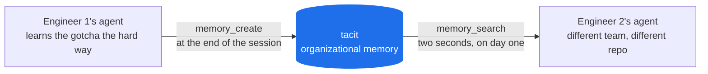
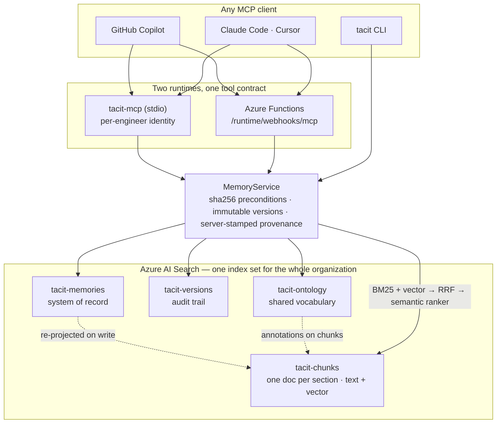

# tacit

**Organizational memory for AI coding agents.**

Copilot gave every developer a memory. Nobody gave the organization one. tacit
is a governed, searchable memory that every MCP-speaking agent (GitHub Copilot,
Claude Code, Cursor, your own) on every team writes to and reads from, hosted in
your Azure tenant.

> A repository records what was built. It never records what was rejected, why
> a decision went the way it did, or the three days someone spent on the wrong
> theory. That knowledge lives in incident channels and in people's heads, and
> it leaves when they do. tacit is where it lives instead.



## What you get

- **Answers across team boundaries.** One search reaches your repo's memory
  plus everything other teams published. A hit from another team says so.
- **Provenance instead of a stale directory.** Every memory is stamped with
  who wrote it, server-side. "Who should I ask?" resolves to a person.
- **Governed history.** Updates append immutable versions, deletes tombstone,
  concurrent edits return a structured conflict. Nothing is silently lost.
- **A shared vocabulary.** "pmt-gw", "the gateway" and "the payments gateway"
  find the same memory, deterministically, with no model on the query path.
- **A picture of the overlap.** A graph where an entity known to two or more
  teams turns orange, because that is knowledge about to be relearned.
- **Any client, one server.** An MCP server on Azure Functions or per-engineer
  stdio, with an identical tool surface. No plugin, no editor lock-in.

## How it works



A memory is one durable fact in Markdown, addressed by `(project, path)`. It has
no file on disk anywhere. Searches run against sections, rank three ways at once
inside one Azure AI Search request, and return the matching section rather than
the whole memory. Reach is decided by the memory's **visibility** and the query's
**scope**, evaluated against the server's own identity, never against the project
a caller names.

The full walk-through with diagrams of every path is in
[**docs/architecture.md**](docs/architecture.md). The reasoning behind each
decision is in [DESIGN.md](DESIGN.md).

## Quick start

Five minutes against a real Search service. What you try here is exactly what
your team gets.

```bash
uv sync --extra dev
az login
export TACIT_SEARCH_ENDPOINT=https://<svc>.search.windows.net

uv run tacit provision          # the four shared indexes, once per service

# Engineer 1's agent stored seven learnings about the sample project:
uv run tacit seed samples/memories --project contoso-payments

# Engineer 2, day one — one call instead of reading the repo:
uv run tacit search "webhook signature fails staging" --project contoso-payments

# A different team's repo reaches the same knowledge:
uv run tacit search "webhook signature fails staging" --project search-svc --scope org

# See the overlap:
uv run tacit ui
```

`provision` runs once per Search service, not once per team. Every project
writes into the same index set, which is what lets one team's memory answer
another team's question. Onboarding a team is pointing it at the endpoint with
its own project slug.

To turn on the vector layer, set an embedding endpoint before `provision`, or
add it later and `reindex`:

```bash
export TACIT_EMBEDDING_ENDPOINT=https://<aoai>.openai.azure.com
uv run tacit provision && uv run tacit reindex
```

## Wire up your team

```bash
uv run tacit install --project contoso-payments \
    --search-endpoint https://<svc>.search.windows.net \
    --function-app <app-name>          # the no-clone remote variant
```

This prints ready-to-paste config for Claude Code, VS Code / GitHub Copilot
(`.vscode/mcp.json`), Copilot CLI and the deployed Functions endpoint, plus an
`AGENTS.md` snippet that tells agents to search memory before exploring. Commit
both. Wiring without instructions gets ignored.

In a repo that has never used team memory, ask the agent to run **`tacit_setup`**.
It is a tool, not only a prompt, because tools reach every client and transport.
The two-minute version for teammates is [TEAM-ONBOARDING.md](TEAM-ONBOARDING.md).

### MCP tools

| Tool | Purpose |
| --- | --- |
| `tacit_setup` | Standing instructions the agent writes into `AGENTS.md`. Start here. |
| `memory_search` | Ranked sections across teams. Filters: `scope`, `category`, `entity`. |
| `memory_brief` | One-call onboarding pack for a project. |
| `memory_read` · `memory_list` | Read one memory, or list them. `read` returns the sha and the author. |
| `memory_create` · `memory_update` · `memory_delete` | Mutations. Update and delete require `expected_sha256`. |
| `memory_versions` | Who wrote each version, and when. |

Every tool takes an optional `project`, because one endpoint serves every repo.

## Who sees what

| Visibility | Who can find it |
| --- | --- |
| `org` *(default)* | Anyone in the organization |
| `team` | Projects belonging to the same team as the server |
| `private` | Only the project that wrote it |

| Scope | What a search covers |
| --- | --- |
| `project+org` *(default)* | This repo plus what other teams published |
| `project` | This repo only |
| `org` | Other teams only. "Has anyone else solved this?" |

Permission is evaluated against the server's configured project and team, never
against the project named in a call. Naming another team's project routes a
request without granting its privileges, and a denied read reports `not_found`.

> **Visibility is a relevance boundary, not access control.** Anything published
> org-wide is reachable by anyone who can call the endpoint. Real access control
> is Entra RBAC on the Search service plus the Functions key. Never store a
> secret in a memory of any visibility.

The three layers, what each one actually enforces, and the path to per-user
identity over HTTP are drawn out in
[docs/architecture.md § Access control](docs/architecture.md#12-access-control-three-layers).

## Seeing the overlap

```bash
uv run tacit ui                       # locally, under your own identity
# deployed: https://<app>.azurewebsites.net/api/ui?code=<function key>
# focus a shared store on a few teams:  ...&projects=team-a,team-b&project=<home>
```

Entities in the middle, projects around them, orange when more than one team
knows something. The page includes a search box over the same `memory_search`
tool an agent calls, so it is the fastest way to see what agents actually get.
The graph is built from the same visibility rules as search, so a private memory
contributes no node, edge or count. The `projects` focus applies after
visibility and is bookmarkable.

The Function App also serves a public, anonymous story page at
`https://<app>.azurewebsites.net/api/` for teams evaluating tacit before they
have a key. It renders no tenant data and loads nothing from a CDN.

## Deploy

```bash
azd up      # AI Search + Flex Consumption Functions + Azure OpenAI embeddings + RBAC, keyless
```

Teammates point their MCP client at
`https://<app>.azurewebsites.net/runtime/webhooks/mcp` with the `mcp_extension`
system key as `x-functions-key`. To reuse an embedding model you already have,
set `azd env set EMBEDDING_ENDPOINT https://<existing>.openai.azure.com` and
grant **Cognitive Services OpenAI User** on it to the two principals the template
outputs. Pass `embeddingModel=""` to run keyword plus semantic only.

> The bicep defaults to AI Search's **Serverless tier** (preview): billed per
> compute unit and GB stored, limited to westcentralus / switzerlandnorth /
> japaneast, no SLA. Pass `searchSku=basic` for production or other regions.
>
> MCP **prompts are not registered on Functions**: the extension's prompt trigger
> needs Python 3.13 while the remote build resolves 3.12. Every workflow is a
> tool instead. The stdio server registers them.

### Configuration

| Env var | Meaning |
| --- | --- |
| `TACIT_SEARCH_ENDPOINT` | Azure AI Search service (required) |
| `TACIT_PROJECT` | Repo slug this process reads and writes (stdio infers it from the folder) |
| `TACIT_TEAM` | Owning team. Resolves `visibility: team` |
| `TACIT_ACTOR` | Who writes are attributed to (defaults to the OS user) |
| `TACIT_DEFAULT_VISIBILITY` | Visibility for new memories (default `org`) |
| `TACIT_AUTH_MODE` | `default-credential` (default) or `azure-cli` |
| `TACIT_EMBEDDING_ENDPOINT` | Azure OpenAI endpoint. Set it to enable the vector layer |
| `TACIT_EMBEDDING_DEPLOYMENT` | Embedding deployment (default `text-embedding-3-small`) |
| `TACIT_EMBEDDING_MODEL` | Model behind that deployment, for the query-time vectorizer |
| `TACIT_EMBEDDING_DIMENSIONS` | Vector size (default `1536`) |
| `TACIT_USE_VECTORIZER` | Let Search embed queries (default `true`) |

## Does it pay for itself?

The benchmark in `benchmark/` answers the same onboarding questions **cold**
(the agent explores the repo) and **warm** (one `memory_search`), charging both
paths honestly. The last published run cut token cost by roughly two thirds,
with every warm answer verified to contain the right fact. Those figures came
from a backend that no longer exists, so regenerate them before quoting:

```bash
uv run tacit bench --backend search --project contoso-payments
```

## Documentation

| Read this | For |
| --- | --- |
| [docs/architecture.md](docs/architecture.md) | How it fits together: runtimes, data model, write and read paths, ranking, governance, deployment, with diagrams |
| [DESIGN.md](DESIGN.md) | Why each decision was made, the invariants, and the retrieval model in depth |
| [TEAM-ONBOARDING.md](TEAM-ONBOARDING.md) | The two-minute setup you hand a teammate |
| [demo/README.md](demo/README.md) | Two demo scenarios with seed data, real repos and spoken scripts |
| [benchmark/RESULTS.md](benchmark/RESULTS.md) | The cold-versus-warm token experiment |

## Related work

- **foundry-iq-cli** answers "what do the documents say". tacit answers "what
  has the team already learned". An agent checks team memory first, then the
  document knowledge base, then the repo.
- **Anthropic memory stores** give Claude managed agents mounted, versioned
  memory. tacit earns its keep when the team is mixed or when memory must live
  in your Azure tenant. `dream.Consolidator` is a protocol, so a real Dream can
  replace the heuristic consolidator.

## Development

```bash
uv sync --extra dev
uv run --extra dev pytest -q                                   # hermetic, no Azure calls
az bicep build --file infra/main.bicep --stdout > /dev/null   # infra lint
```

Security red lines: no secrets in payloads, config or MCP wiring; mutations
always require the caller's `expected_sha256`; dreams never modify their input
store; visibility is a relevance boundary, never a substitute for RBAC.
