# tacit — architecture

How organizational memory for AI coding agents is built on Azure: the pieces,
the request paths, the ranking pipeline, the governance model, and what happens
when a layer is missing. [DESIGN.md](../DESIGN.md) records *why* each decision
was made; this document shows *how* it fits together.

**Contents**

1. [System context](#1-system-context)
2. [Two runtimes, one tool contract](#2-two-runtimes-one-tool-contract)
3. [Data model: one index set per organization](#3-data-model-one-index-set-per-organization)
4. [Write path](#4-write-path)
5. [Read path and the ranking pipeline](#5-read-path-and-the-ranking-pipeline)
6. [Reach: scope, visibility and the viewer](#6-reach-scope-visibility-and-the-viewer)
7. [Shared vocabulary](#7-shared-vocabulary)
8. [The overlap graph](#8-the-overlap-graph)
9. [Adoption loop](#9-adoption-loop)
10. [Graceful degradation](#10-graceful-degradation)
11. [Deployment topology](#11-deployment-topology)
12. [Access control: three layers](#12-access-control-three-layers)
13. [Dream: consolidation](#13-dream-consolidation)
14. [Repository map](#14-repository-map)

---

## 1. System context

Three kinds of organizational knowledge, three places it lives. Repositories
hold what was built. Work IQ (Microsoft 365) holds what exists. tacit holds what
the organization has *learned* — decisions, dead ends, gotchas, constraints —
and serves it to every agent over MCP.

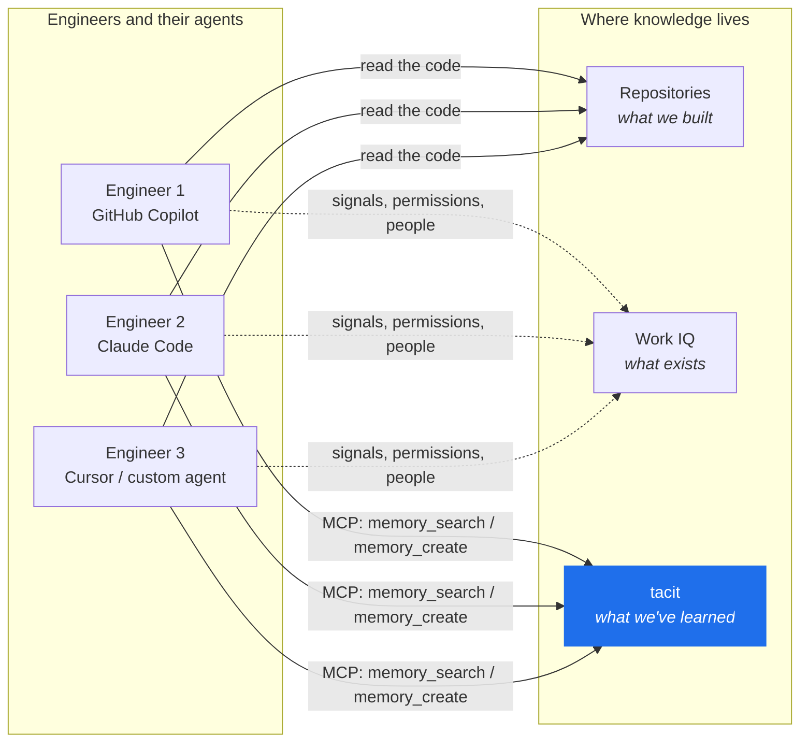

The unit of value is a **memory**: one durable fact, written in Markdown,
addressed by `(project, path)`, versioned, attributed, and searchable by any
team whose visibility rules allow it. A memory has no file on disk anywhere.
`/gotchas/webhook-header-casing.md` is an address, not a path.

---

## 2. Two runtimes, one tool contract

The same nine MCP tools are served two ways. Engineers who clone the repo run a
stdio server under their own Entra identity. Everyone else points their client
at an Azure Functions endpoint and never installs anything. Both runtimes call
the same `call_tool` dispatcher, so the tool surface cannot drift between them.

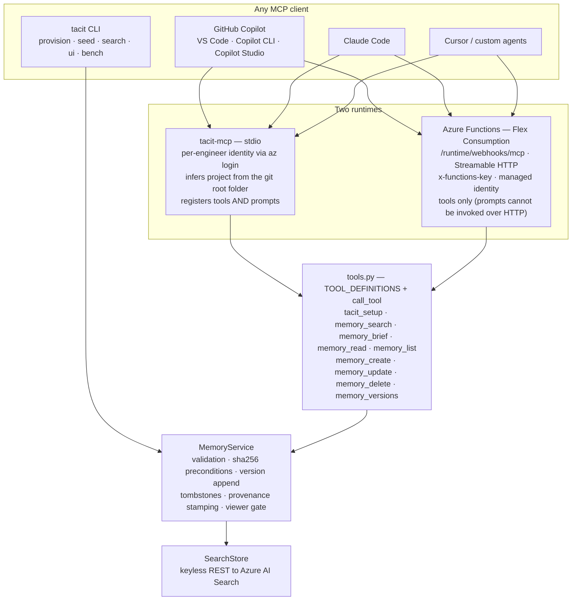

Every tool accepts an optional `project` argument because one endpoint serves
every repository. The agent infers the slug from the repository folder name
(`~/work/Contoso Payments` → `contoso-payments`). On the shared endpoint that
value is a **routing hint, never a permission** — see [section 6](#6-reach-scope-visibility-and-the-viewer).

| Tool | What it does |
| --- | --- |
| `tacit_setup` | Returns the standing instructions an agent writes into `AGENTS.md`. Idempotent. |
| `memory_search` | Ranked sections across teams. `query`, `top`, `category`, `scope`, `entity`. |
| `memory_brief` | Every `onboarding` memory of a project, in one call. |
| `memory_read` | One memory by path, with `content_sha256`, `created_by`, `updated_by`. |
| `memory_list` | Paths, titles and categories of active memories, optional prefix. |
| `memory_create` | New memory. Fails if the path exists. |
| `memory_update` | Appends a version. Requires `expected_sha256`; returns `sha_conflict` on a race. |
| `memory_delete` | Tombstone. Requires `expected_sha256`. History is kept. |
| `memory_versions` | The audit trail: who wrote each version and when. |

---

## 3. Data model: one index set per organization

Four Azure AI Search indexes hold the whole organization. `project`, `team` and
`visibility` are filterable fields, not index names, so a query can cross a team
boundary in one request and onboarding a team costs no new infrastructure.
`tacit provision` runs once per Search service.

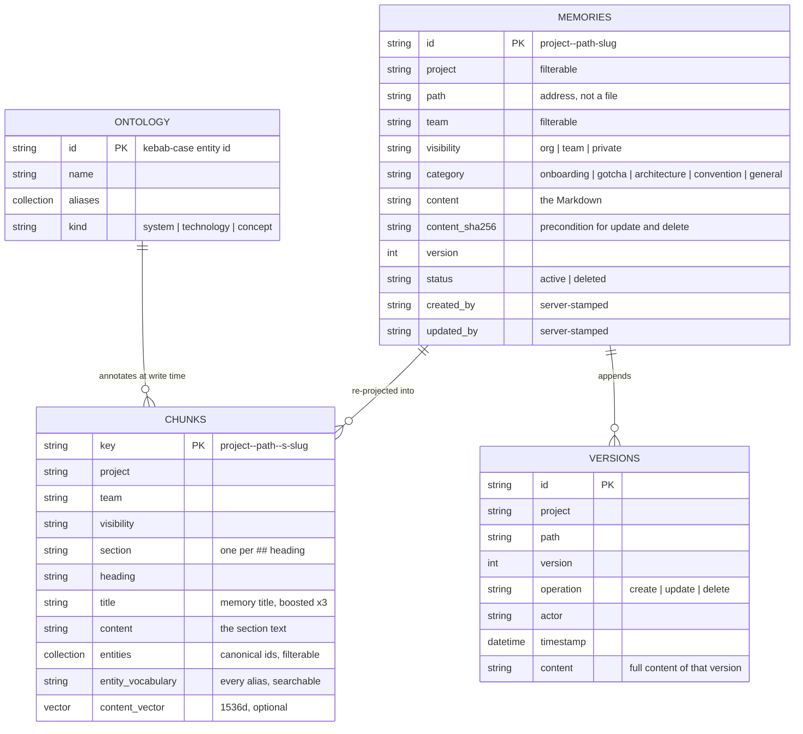

| Index | Role | Who reads it |
| --- | --- | --- |
| `tacit-memories` | System of record. One document per `(project, path)`. Source of `content_sha256`. | `read`, `list`, `brief`, mutations, graph |
| `tacit-chunks` | **Derived and disposable.** One document per `##` section. The index queries run against. | `search`, the UI search box |
| `tacit-versions` | Append-only audit trail with the full content of every version. | `versions` |
| `tacit-ontology` | The organization's controlled vocabulary. | annotation on write, graph, `entity` filter |

The chunk split is adaptive. A memory with no `##` headings, tacit's usual
"one focused fact" shape, stays one chunk. A runbook or ADR gains one chunk per
section, so asking about refunds returns the refunds section, not the runbook.
Chunk keys are deterministic, so re-projection is idempotent and `tacit reindex`
can rebuild the whole index at any time.

---

## 4. Write path

Provenance is stamped by the server from its own configuration. A caller never
supplies `project`, `team`, `visibility` defaults or `actor`, because a caller
that could forge a team could read that team's private notes.

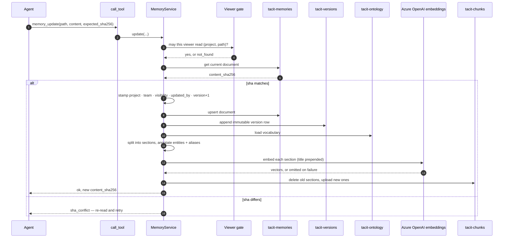

Rules the write path enforces:

- **Immutable history.** `update` appends. `delete` writes a tombstone version
  and removes the chunks, so retracted content can never surface in a hit.
- **Optimistic concurrency.** Every mutation carries the `content_sha256` the
  caller last read. A mismatch is a structured `sha_conflict`, not an opaque
  error, so agents re-read and retry deliberately.
- **Writers embed.** Memories are pushed through the documents API, which is
  what makes sha preconditions possible, so index-time vectorization is not
  available. Section vectors are computed by whoever writes.
- **Vocabulary is applied on write.** Each chunk carries the canonical entity
  ids it mentions and every alias as searchable text. Widening the vocabulary
  later is a `reindex`, not a query-path change.

---

## 5. Read path and the ranking pipeline

A search is one request that ranks three ways at once, then two local steps
shape what the agent pays tokens for.

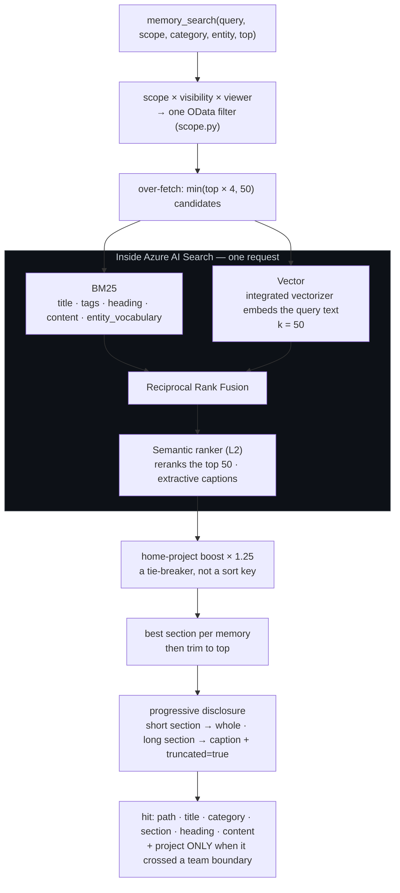

Why each stage exists:

| Stage | Reason |
| --- | --- |
| One OData filter from `scope.py` | Every read path derives reach from one definition, so search, `read`, `list`, `versions` and the graph cannot disagree about what leaks. |
| Over-fetch | The boost and the best-per-memory rule both reorder and drop rows. Asking for exactly `top` would routinely return fewer. |
| BM25 over aliases too | A memory written as "pmt-gw" is found by "payments gateway" because the vocabulary put both words on the chunk. |
| Vector with `k = 50` | The reranker window is 50 rows. A smaller `k` starves the stage that decides the final order. |
| Semantic ranker | A plain-language question outranks keyword overlap. The scoring profile (title ×3, tags ×2, freshness) is dropped here because L2 never sees BM25 order; it applies only on the BM25 fallback path. |
| Home boost after ranking | Local knowledge wins ties. Another team's clearly better answer still surfaces first. |
| Best section per memory | A long memory should cost one hit, not five near-duplicates. |
| Narrow, one field | A snippet next to the text it summarises is duplication the caller pays for twice. Measured: emitting both dropped the benchmark from 65% to 54%. |
| `project` only on cross-team hits | Its presence *is* the signal that a result crossed a boundary. On a same-project hit it would be per-call noise. |

Retrieval quality depends on the question naming the **shape** of the system
rather than a generic symptom. In a store that also holds unrelated projects,
"what production issues should I know about?" ranks generic gotchas from every
team; "production issues for an agent with signed webhooks, human approvals and
accumulating chat history" ranks the relevant team's four memories first. The
standing instructions from `tacit_setup` tell agents to search with focused
keywords for exactly this reason.

---

## 6. Reach: scope, visibility and the viewer

Reach is the product of the memory's **visibility** and the query's **scope**,
evaluated against the **viewer**: the project and team this server was
configured with, never the project named in the call.

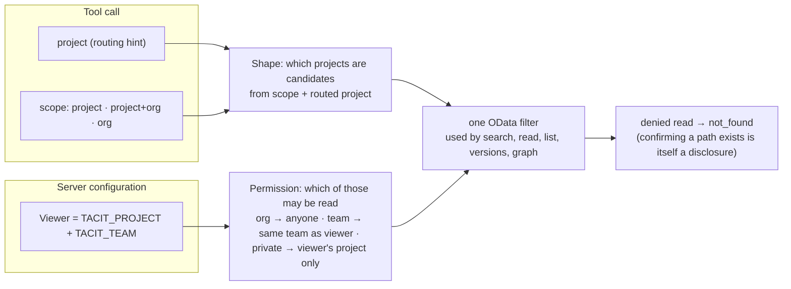

| Visibility | Who can find it |
| --- | --- |
| `org` *(default)* | Anyone in the organization |
| `team` | Projects belonging to the same `TACIT_TEAM` as the viewer |
| `private` | Only the project that wrote it |

| Scope | What it searches |
| --- | --- |
| `project+org` *(default)* | This repo plus what other teams published |
| `project` | This repo only |
| `org` | Other teams only. "Has anyone else solved this?" |

Defaults do the work. Memories default to `org` because knowledge that cannot
leave its team is not organizational memory. Searches default to `project+org`
because an agent that has to *know* to ask for the rest of the organization will
not ask.

> **What visibility is not.** It is a relevance boundary. Anything published
> `org`-wide is reachable by anyone who can call the endpoint, by design. Real
> access control is Entra RBAC on the Search service plus the Functions key.
> Never store a secret in a memory of any visibility.

The routing-versus-permission split closed a real privilege escalation found in
code review: when the caller-supplied `project` also decided permission, any
agent could read and overwrite another team's `private` memories through the
shared endpoint. When a routing hint and an authorization principal are the same
field, that is privilege escalation. They are separated structurally in
`scope.py`, and a parity test cross-checks the OData filter against the local
predicate over every combination.

---

## 7. Shared vocabulary

Reach solves "your memory is invisible to me". It does not solve "we call it
different things". The vocabulary is a small set of canonical entities with the
aliases teams actually type, applied deterministically at write time.

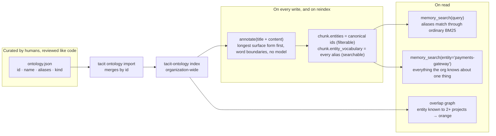

Normalizing on write rather than expanding on read keeps query latency
untouched, keeps the semantic ranker looking at the user's real question instead
of an OR-expanded alias soup, and lets the vocabulary grow without any query
path changing. The cost is that annotations are stale until re-chunked, which
the CLI says after every vocabulary change. A missing vocabulary degrades to no
annotation, never to a failed write.

---

## 8. The overlap graph

Adoption is an argument, and the argument is easier to see than to read. The
graph puts entities in the middle and the projects that wrote about them around
the outside. An entity touched by two or more projects turns orange: that is
knowledge somebody is about to rediscover the hard way.

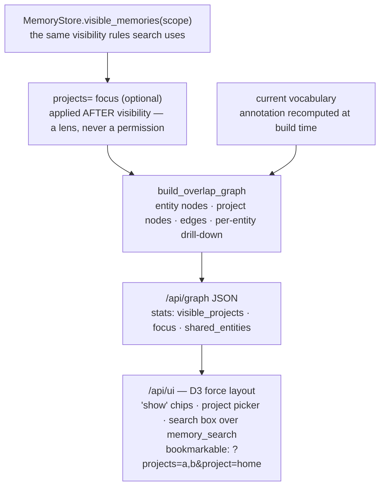

Three properties hold by construction:

- **Per-viewer.** It is built from `visible_memories`, so a private memory
  contributes no node, no edge and no count, and cannot make a shared entity
  *look* shared.
- **Focus hides, never reveals.** `?projects=a,b` filters after visibility. The
  response still carries the full `visible_projects` list so the picker does
  not lose options, and a malformed slug is a 400.
- **The search box is the tool.** It goes through `call_tool` to
  `memory_search`, so what an operator sees is exactly what an agent gets,
  including the "from *other-team*" badge.

---

## 9. Adoption loop

Nothing auto-populates. A memory exists only because an agent called
`memory_create`, and an agent calls it only if something told it to. The
countermeasures are structural, not documentary.

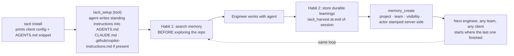

Why `tacit_setup` is a **tool** and not only a prompt: MCP prompts do not reach
everyone. Copilot Studio supports tools and resources but not prompts, and on
the Functions HTTP transport prompts register but cannot be invoked. A
capability unavailable on the transport most colleagues use is not one to build
adoption on. The instruction block lives in one place, and a test asserts the
three renderers (`tacit install`, the tool, the stdio prompt) agree.

---

## 10. Graceful degradation

Retrieval must never become the reason a memory is lost or a question goes
unanswered. Each layer fails on its own.

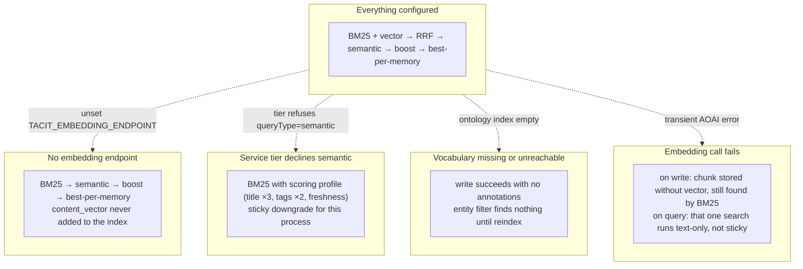

One consequence worth knowing when operating a deployment: on a runtime with no
vector layer, an `entity`-filtered search whose query words never appear in the
filtered chunks returns nothing. That is BM25 doing exactly what it does, not a
bug in the filter. Configure `TACIT_EMBEDDING_ENDPOINT` on the Function App to
add vector recall.

---

## 11. Deployment topology

`azd up` provisions everything in `infra/main.bicep`. Keyless by default: the
Function App and the Search service use managed identities, and the deployer
gets the same roles for local runs.

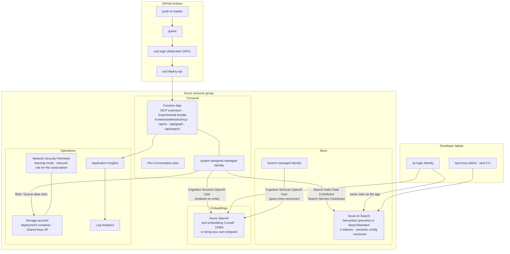

Settings the Function App needs, and what each one changes:

| App setting | Effect |
| --- | --- |
| `TACIT_SEARCH_ENDPOINT` | Required. Which Search service holds the index set. |
| `TACIT_PROJECT`, `TACIT_TEAM` | The **viewer**. Decide what `team` and `private` memories this endpoint may read. |
| `TACIT_ACTOR` | What `created_by` / `updated_by` say for writes through this endpoint. Unset, it is the host's OS user. |
| `TACIT_EMBEDDING_ENDPOINT` | Turns on the vector layer for writes and queries made through this runtime. Requires the OpenAI User role on the target resource. |
| `TACIT_ENABLE_MCP_PROMPTS` | Off by default on Functions. Prompts register but cannot be invoked over HTTP with the Python 3.12 remote build. |

Two operational notes learned the hard way:

- **`tacit provision` PUTs the full schema.** Run the CLI with the same
  `TACIT_EMBEDDING_ENDPOINT` the index was built with, or Azure rejects the PUT
  with "Existing field(s) 'content_vector' cannot be deleted".
- **Azure returns HTTP 207 for partial batch success**, and caps indexing
  batches at 1000 documents / 16 MB. The store parses per-document status
  rather than trusting `raise_for_status`.

---

## 12. Access control: three layers

Only the first layer is authorization. The second is a shared secret. The third
is a relevance boundary. Knowing which is which is what keeps a secret out of a
memory.

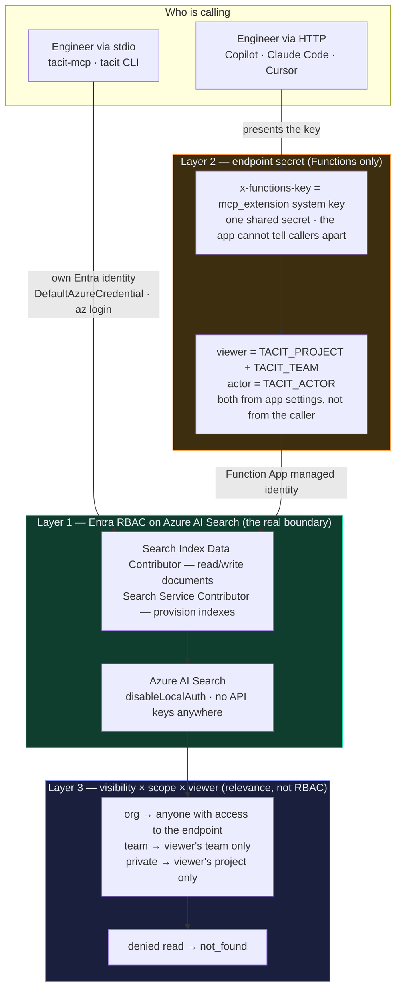

| Layer | What it decides | Granularity today | Where it lives |
| --- | --- | --- | --- |
| **1. Entra RBAC on Search** | Whether a principal can read or write documents at all | Per engineer over stdio; one managed identity for the whole Function App | `infra/main.bicep` role assignments; `azure_common.build_credential` |
| **2. Functions key** | Whether an HTTP caller reaches the MCP endpoint | One shared secret for everyone who holds it | Functions host; `TEAM-ONBOARDING.md` |
| **3. Visibility × scope × viewer** | Which visible memories a request may return | Per *server configuration*: the viewer is `TACIT_PROJECT` + `TACIT_TEAM` | `scope.py`; `Memory.readable_by`; every read path |

What follows from this, stated plainly:

- **Over stdio, identity is real.** Each engineer authenticates to Search as
  themselves, so Search RBAC and `created_by` are per person.
- **Over the shared HTTP endpoint, identity is the deployment.** Every caller is
  the same viewer and the same actor. `team` visibility has no effect unless the
  app is configured with a team, and `created_by` names `TACIT_ACTOR`, not the
  person. Provenance over HTTP identifies the deployment.
- **`org` memories are reachable by anyone who can call the endpoint.** By
  design. Never store a secret in a memory of any visibility.

### Where per-user control would come from

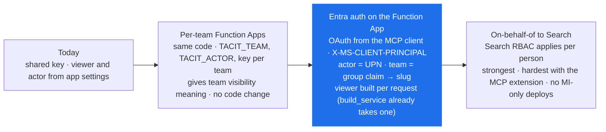

The recommended step is the second: the viewer abstraction already exists and
`build_service(settings, viewer=...)` already accepts an override, so per-request
identity is header parsing, a group-to-team mapping and a per-viewer service
cache, not a storage change.

---

## 13. Dream: consolidation

`tacit dream` curates a store into a **new** one, never modifying its input, so
the result can be reviewed and discarded. The default consolidator is
deterministic and hermetic; `Consolidator` is a protocol, so an LLM-backed
implementation can be swapped in.

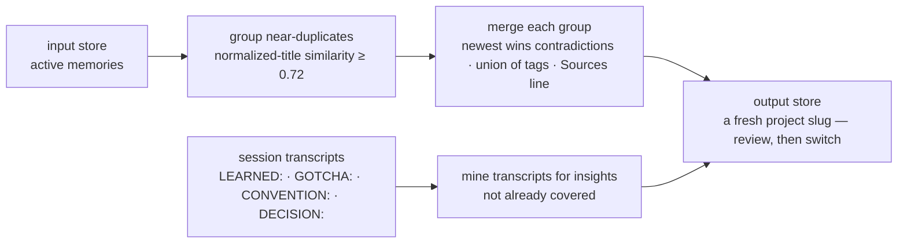

---

## 14. Repository map

```
src/tacit/
    models.py        Memory · MemoryVersion · Visibility · SearchScope · validators
    scope.py         the one definition of reach: OData filter + local predicate
    service.py       validation, concurrency, tombstones, provenance stamping
    search_store.py  Azure AI Search backend, keyless REST, ranking pipeline
    search_index.py  the four index schemas + provision
    sections.py      adaptive ## chunking + progressive disclosure (narrow)
    embeddings.py    Azure OpenAI embeddings for the vector half
    ontology.py      shared vocabulary + deterministic matcher
    graph.py         overlap graph (pure: memories + ontology → nodes/edges) + projects focus
    ui.py            the graph page, shipped as a module constant
    landing.py       the public story page (no tenant data, no CDN)
    tools.py         TOOL_DEFINITIONS + call_tool — the one tool contract
    prompts.py       tacit_setup / onboard / recall / remember / harvest
    mcp_stdio.py     stdio MCP server
    dream.py         consolidation pipeline
    config.py        TACIT_* settings (pydantic-settings)
    cli.py           provision · seed · search · read · brief · reindex · ontology · ui · dream · bench · install
functions/           Azure Functions app: one mcpToolTrigger per tool + HTTP routes
infra/               bicep + azd: Search, Functions Flex, Azure OpenAI, RBAC, NSP
demo/                two demo scenarios, seed data, real repos with planted bugs, scripts
samples/             contoso-payments sample repo, seed memories, transcripts
benchmark/           cold-vs-warm token experiment
tests/               hermetic; no Azure calls
```
