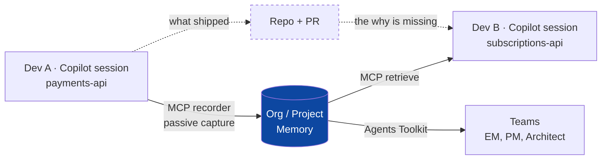

Here's a complete storyline. I've built it around one specific, technically plausible scenario — vague "knowledge sharing" demos don't sell; a story where the audience *feels* the bug does.

## The core insight (your positioning)

> Your repo records **what** was decided. Copilot reads that perfectly.
> Nobody records **why** — or, more importantly, **what was tried and rejected**.
> Dead ends leave **zero artifacts** in a codebase. They are the most expensive knowledge your org produces and the only knowledge that is completely invisible to code search, RAG, and Copilot.

And the twist that makes this urgent rather than nice-to-have:

> Copilot doesn't fix this — it *amplifies* it. It makes every developer confidently fast at repeating a mistake a colleague already paid for.

---

## The scenario: "The Retry That Charged Twice"

**Setting:** A fintech platform. Payments team in Singapore, Subscriptions team in Lisbon. Two different repos. The two developers have never met. Both have Copilot.

### Act 1 — Developer A pays the tuition (2 days)

**Priya**, senior engineer on `payments-api`, is on incident INC-3391: customers double-charged during a partial outage of their payment provider, **Nexora Pay**.

Two days of Copilot-assisted digging surfaces the truth:

- Nexora's `POST /v2/charge` returns **504 after 30s — but the charge has already committed** on their side.
- Their docs claim idempotency keys are honored for **24 hours**. They are actually honored for **60 seconds**. Confirmed only via vendor support ticket **#4471**.
- So the textbook fix — exponential backoff, 3 retries, same idempotency key — is the *cause*: attempt 1 burns 30s, attempt 2 burns 30s, retry 3 lands at **t=70s**, outside the dedupe window → **a second, real charge.**
- The bug only appears when Nexora is *slow* — i.e. exactly during an outage — i.e. exactly when retries matter. **No test catches it**, because every mock dedupes forever.

Along the way she tried and rejected:
- Wrapping in a DB transaction → useless, the call is external.
- Nexora's official SDK retry helper → same 60s window, same bug.
- A distributed lock → added 40ms p99 and still broke on pod restart.

**The fix ships.** Commit message: `fix: cap retry window for Nexora charge calls`. She even leaves a comment: `// do not increase this backoff`.

Where the reasoning now lives: her head, a Teams thread, and a Copilot session. **Not in the repo.**

### Act 2 — Developer B pays it again (the gap)

Six weeks later. **Marco**, `subscriptions-api` — a *different repo* — is wiring up recurring billing against the same vendor. Staging throws a timeout.

He asks Copilot: *"How should I handle timeouts calling the Nexora charge API?"*

Copilot answers — grounded, confident, well-formatted, and **catastrophically wrong**:

> Add exponential backoff with 3 retries and an idempotency key.

This is the correct answer in 99% of the world. It's the answer a staff engineer would give. It will **pass code review**, because the reviewer doesn't know either. Priya's code comment doesn't save him — it's in a repo he has no reason to open, and he doesn't know the search term.

It ships. The next Nexora blip double-charges 4,000 subscribers.

> **This is the money moment of the video.** Copilot didn't fail — it did its job. It just didn't know something the organization already knew.

### Act 3 — With your asset

Rewind. Priya's session ran with the **memory MCP server** attached to her Copilot harness. As a *byproduct* of work already happening, it captured the decision trail — hypotheses, the vendor ticket, the rejected alternatives **with reasons**, the final constraint — and distilled it into org memory with provenance: *`INC-3391 · PR #882 · Priya · 12 Jul · verified`*.

Marco asks the same question. His harness resolves org memory first:

> ⚠️ **Don't add unbounded backoff here.** Nexora honors idempotency keys for **60s**, not the documented 24h (vendor ticket #4471, INC-3391). Total retry budget must stay inside 60s; beyond that, reconcile via `/v2/charge/lookup` before retrying.
> *Already tried and rejected:* SDK retry helper (same window), distributed lock (+40ms p99, fails on pod restart).
> *Source:* payments-api PR #882, Priya S.

**Two days of investigation and a production incident, collapsed into one answer — across a repo boundary, an org boundary, and a person who left the team.**

### Act 4 — The Teams beat (why this is *organizational* memory)

Priya's EM never opens an IDE. In Teams she asks the Agents-Toolkit-wrapped agent: *"What do we know about Nexora's reliability?"*

Same memory. Different surface. Now it's a **vendor risk review**, not a bug.

> One memory. Three surfaces: A's IDE → B's IDE → the org's conversation layer.

---

## The architecture beat (one slide / one shot)

The dotted path is the status quo. The solid path is you.

---

## Video storyboard (4:00, with a 60s cut-down)

| # | Time | Shot | Narration / on-screen |
|---|---|---|---|
| 1 | 0:00–0:20 | Black screen, one line of text | *"In 2026, every developer has an AI assistant. So why does your team still solve the same problem twice?"* |
| 2 | 0:20–0:55 | Screen rec: Priya's session, 2 days compressed. Show failed attempts fast-cut. End on the green PR. | *"Priya spent two days and one production incident learning that a vendor's docs were wrong."* |
| 3 | 0:55–1:10 | Zoom on commit msg `fix: cap retry window…` then on the diff | *"Here's everything the organization kept: nine words and a diff. The two days? Gone."* |
| 4 | 1:10–1:50 | **Marco, no memory.** Live Copilot prompt → the confident wrong answer. Freeze frame. Red overlay. | *"Six weeks later, different repo, different continent. Copilot gives the textbook answer. It's correct everywhere except here."* **Beat of silence.** |
| 5 | 1:50–2:05 | Cut to a "4,000 duplicate charges" alert / incident channel | *"He wasn't slow. He was fast — at repeating a mistake we'd already paid for."* |
| 6 | 2:05–2:20 | Title card | **"Copilot gave every developer a memory. Nobody gave the organization one."** |
| 7 | 2:20–2:45 | Rewind SFX. Show the MCP recorder attached to Priya's harness. Show the captured memory object with provenance. **Emphasize: she did nothing extra.** | *"No wiki. No ADR. No 'please document this.' Capture is a byproduct of the work."* |
| 8 | 2:45–3:20 | **Marco, with memory.** Identical prompt → the grounded warning + rejected alternatives + citation. | *"Same question. Same tool. Different organization."* |
| 9 | 3:20–3:40 | Teams window. EM asks the vendor-risk question. Same memory, business framing. | *"And because it's MCP wrapped in Agents Toolkit, the memory isn't trapped in an IDE."* |
| 10 | 3:40–4:00 | Close | *"Individual velocity is a solved problem. Organizational velocity isn't. **[Asset name]** — your org's memory, in every session."* |

**60s cut:** shots 4 → 5 → 6 → 8 → 10. The wrong answer, the consequence, the title card, the right answer, the tagline.

**Two production notes that matter more than they sound:**
- **Shot 4 and shot 8 must be the same prompt, same model, same UI, side by side.** The only variable is your MCP server. That's the entire proof.
- **Never make Copilot look dumb.** Its wrong answer must be *good* — well-reasoned and best-practice. If the audience thinks "Copilot is just bad," you've sold nothing. If they think "I would have written that exact code," you've sold everything.

---

## Taglines (pick one, use it everywhere)

1. **"Your repo remembers what. Nobody remembers why."** ← my pick
2. "Copilot gave every developer a memory. This gives the organization one."
3. "The most valuable thing your team knows is what *doesn't* work. None of it is in your codebase."
4. "Stop paying twice for the same lesson."
5. "200 developers with Copilot = 200 people repeating each other's mistakes, very fast."

---

## Objection handling (put these in the FAQ / second half of the deck)

| Objection | Your answer |
|---|---|
| *"Isn't this just RAG over our repo?"* | Rejected alternatives leave **no artifact** to index. Priya's distributed-lock experiment exists in no commit, no file, no PR. Code RAG is structurally incapable of retrieving it. |
| *"We have ADRs / a wiki for this."* | Capture happens at the moment of **lowest motivation** — you just fixed it at 2am and want to move on. Our capture cost is **zero**; it's a byproduct. Also: nobody writes an ADR for "the vendor's docs lie." It doesn't feel important enough — until it costs $180k. |
| *"Copilot already has memory."* | Session-scoped and user-scoped. Priya's memory never reaches Marco. Ours is **org-scoped, cross-repo, cross-person, and survives attrition.** |
| *"What about stale memory?"* | Critical, and worth showing you've thought about it: every entry carries **provenance, a timestamp, and a confidence/verification signal**, and can be invalidated. When Nexora fixes the window in 2027, the memory is superseded — not silently wrong. Stale memory is worse than none, and we treat it that way. |
| *"Security — is this leaking code across teams?"* | Memory **inherits repo ACLs**. Marco sees it only because both services are in his permission scope. |
| *"How do you know what's worth remembering?"* | Signal-based: incident-linked sessions, sessions with high iteration counts, explicitly flagged decisions. Not everything is memory. |

---

## Metrics to claim in the close

- Time-to-first-correct-answer for a cross-team problem: **days → seconds**
- Repeat-incident rate (same root cause, different service)
- Onboarding ramp for a new joiner in an unfamiliar repo
- **Knowledge retention through attrition** — the CTO-level metric. *"Priya left in March. Her hardest-won lesson didn't."*

---

## Alternate scenarios if fintech doesn't fit your audience

Each has the same shape — **a plausible-but-wrong textbook answer, a cross-repo boundary, and a dead end that left no trace**:

- **Data/AI:** A retrieval eval regressed because a chunking change interacted with a specific embedding model's token limit. Copilot suggests "increase chunk size." It's the exact thing that broke it.
- **Infra:** A K8s HPA can't scale on a custom metric because of a CRD version quirk in *your* cluster. Copilot confidently writes the manifest from the upstream docs.
- **Mobile:** A token-refresh race that only appears on Android 14 cold-start. Fixed once, re-broken in a sibling app.
- **Migration:** An online index build that locks the table on your specific DB minor version. Textbook answer takes prod down at 3am.

---

Want me to turn this into a **slide deck** (`/pptx`) for the pitch, a **shot-list doc** for the recording session, or draft the actual **narration script** verbatim for the voiceover?